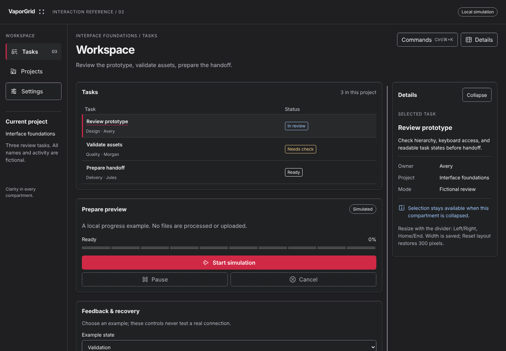
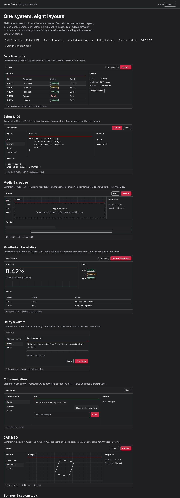
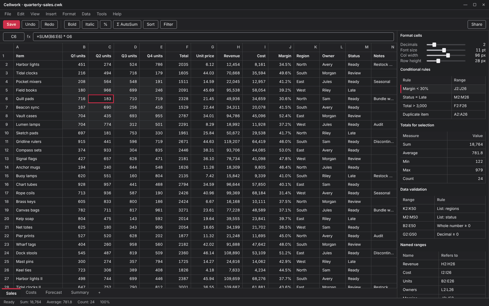
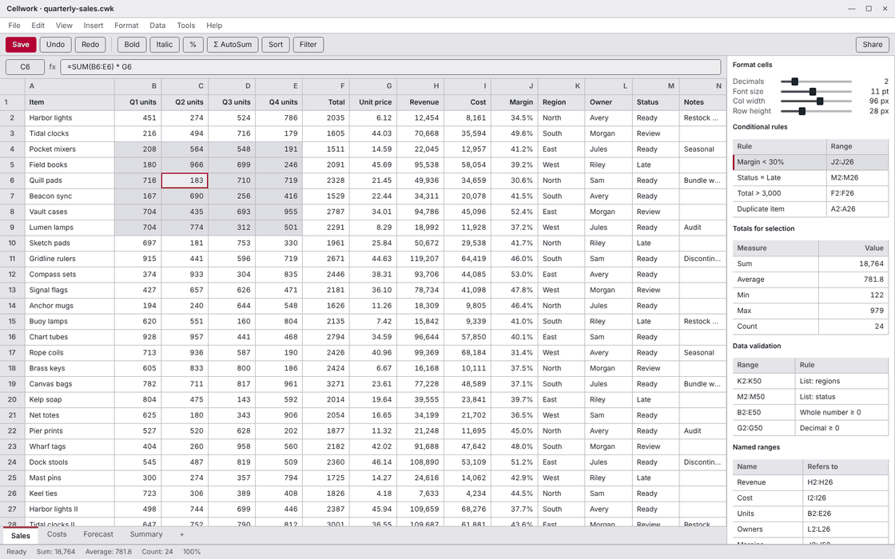
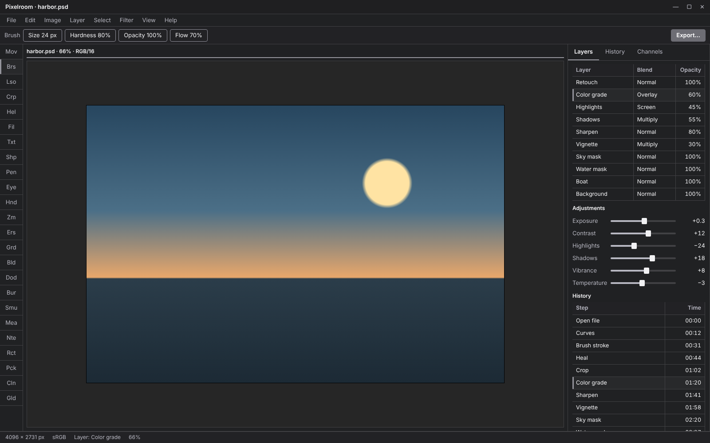
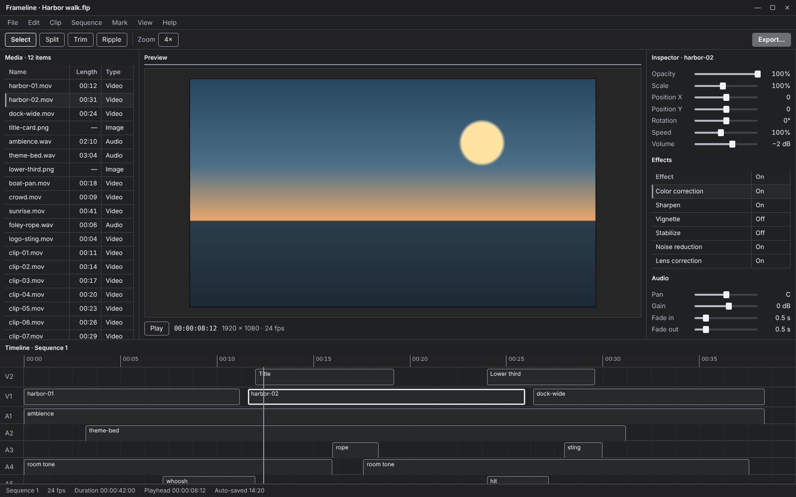

# VaporGrid

A dense, tactile interface standard for desktop software of any kind, in dark and light.

 · [Live demo](https://seanshaffer88.github.io/VaporGrid/demo/) · [Category layouts](https://seanshaffer88.github.io/VaporGrid/demo/categories/) · [Quick reference](docs/quick-reference.md) · Docs [CC BY 4.0](LICENSE) · Code and tokens [MIT](LICENSE-CODE)

> [!NOTE]
> VaporGrid is for engineers and designers building desktop-class editors,
> data tools, media tools, monitors, utilities, communication apps, CAD tools
> and system settings. It specifies the tokens, regions, density and behavior
> needed for long sessions in high-density interfaces.

**Contents** · [Revision 6](#revision-6) · [Six rules](#six-rules) · [See it](#see-it) · [Any category](#any-category) · [Adopt VaporGrid](#adopt-vaporgrid) · [Open questions](#open-questions)

## Revision 6

Crimson primary actions that meet 3:1 on every surface, structure from edges
instead of tiny luminance steps, density chosen per component class, a grid
signature that carries meaning, presets that recolor the whole accent, and a
layout guide for eight product categories. See the [changelog](CHANGELOG.md),
[audit](AUDIT.md) and [decisions](docs/decisions.md). The last tagged release
is [v5.5.0](https://github.com/SeanShaffer88/VaporGrid/releases/tag/v5.5.0).

## Six rules

1. **One dominant region** per view, 55–70% wide. Supporting regions 20–35%.
2. **One crimson element per region**: primary action, selection marker, or active-region rule.
3. **Edges build structure.** A 1px `edge` between compartments. Fills mark hover and selection.
4. **Density follows the component.** Rows, trees and toolbars Compact. Forms, dialogs and navigation Comfortable.
5. **Keyboard first.** Every task has a path, shortcuts are visible, Ctrl/⌘+K opens commands.
6. **Static and honest.** No ambient motion. Real status, real cancel, text with every color.

[One-page quick reference](docs/quick-reference.md) · [Full guidelines](docs/design-guidelines.md)

## See it

  

*Screenshot of the running [reference workspace](https://seanshaffer88.github.io/VaporGrid/demo/), dark theme.*

## Any category

  

*Screenshot of the [category demo](https://seanshaffer88.github.io/VaporGrid/demo/categories/).* The same tokens and rules cover data and records, editors, media, monitoring, wizards, communication, CAD and system tools. Only the dominant region changes. See [category layouts](docs/categories.md).

## Applied to different programs

  

*Slideshow of the mockups below, 3 seconds each. Click any entry to open its full-size image. All programs, names and data are fictional.*

| Program type | What the design does | Mockup |
| --- | --- | --- |
| Spreadsheet | Dominant grid with row and column gridlines, frozen headers, tabular figures, formula bar, one crimson Save | [View](assets/mockups/vaporgrid-spreadsheet.png) |
| File and folder compare | Two synchronized panes, a state list, a differences table, markers that do not rely on color alone, one crimson Merge | [View](assets/mockups/vaporgrid-file-compare.png) |
| Music production | Browser, arrangement with clips, mixer with segmented meters, value controls, one crimson Record | [View](assets/mockups/vaporgrid-music-production.png) |
| Image editor | Neutral viewport around the canvas, tool rail, layers, adjustments, history, one crimson Export | [View](assets/mockups/vaporgrid-image-editor.png) |
| Video editor | Media bin, preview, inspector, multi-track timeline with a playhead, one crimson Export | [View](assets/mockups/vaporgrid-video-editor.png) |
| Code editor | Explorer, editor, symbols, problems table and terminal, status with icon and text, one crimson Run | [View](assets/mockups/vaporgrid-code-editor.png) |
| Program manager | Gridded list of installed programs, filters, details, one crimson Uninstall | [View](assets/mockups/vaporgrid-program-manager.png) |
| Monitoring console | Metric tiles, a chart with a table alternative, events, a node table, one crimson Acknowledge | [View](assets/mockups/vaporgrid-monitoring.png) |

Every mockup follows the same rules: regions fill their space, data lists are gridded, one crimson element per region, edges for structure, a single active-region rule per window.

### Light theme

  

*The same eight programs in the light theme, 3 seconds each. Full-size images are in [assets/mockups/light](assets/mockups/light/).*

### Graphite preset for color-critical work

Image and video tools use the Graphite preset so no tinted chrome sits next to the work. The primary action, selection marker and focus ring are neutral, and the viewport surround stays neutral gray.

| Image editor | Video editor |
| --- | --- |
|  |  |

## Creative and multi-mode tools

See [workspace patterns](docs/workspaces.md) for modes, panels, value controls, timelines and meters.

## Design decisions

| Principle | Decision |
| --- | --- |
| Density has rhythm | 6 CSS px minimum between distinct grouped controls, 8 default, 12–16 between groups, 24 between sections |
| Density is per component | Compact rows (28) and controls (32) for repeated work. Comfortable (36/40) for forms and dialogs. Touch (48). [Density](docs/design-guidelines.md#density) |
| The current task fits | Windows, dialogs, forms and wizard pages fit without scrollbars. Data containers scroll inside their own bounded viewport. The main window never scrolls |
| Crimson is scarce | Primary action `#D02946` (dark) with a white label, 3:1 on every surface. Deep `#76172A` only for large tinted regions with a marker. [Crimson roles](docs/materials.md#crimson-roles) |
| Edges carry structure | Three charcoal levels differ by 5–10% luminance and mark state. A 1px `edge` separates compartments |
| The grid has a job | A 24 px grid in empty states and canvases, ten-segment progress, and a 2px active-region rule. [Grid signature](docs/materials.md#grid-signature) |
| Presets recolor the whole accent | Crimson, Blue, Teal and the neutral Graphite change the primary action, selection, focus and deep accent together |
| Keyboard access starts at the surface | Logical Tab order, visible focus, Commands on Ctrl/⌘+K |

VaporGrid targets [WCAG 2.2 AA](https://www.w3.org/TR/WCAG22/), including 4.5:1
contrast for normal text. The 44 × 44 CSS px touch policy is separate from AA's
24 × 24 target-size criterion. Consult the [verification record](docs/verification.md)
for the checks run and their limits. Static images and unit tests do not replace
keyboard, screen-reader and reduced-motion testing in your application.

## Adopt VaporGrid

- Start with the [quick reference](docs/quick-reference.md), then the [design guidelines](docs/design-guidelines.md) and [component usage](docs/components.md).
- Pick a layout in [category layouts](docs/categories.md). For multi-mode creative tools, add [workspaces](docs/workspaces.md) and review against the [polish checklist](docs/polish.md).
- Use the [CSS custom properties](demo/tokens.css) or [JSON tokens](docs/tokens.json). Choose states with the [materials guide](docs/materials.md).
- Native apps: take a generated export from [`dist/`](dist/): [DTCG JSON](dist/vaporgrid.tokens.json), [WinUI 3](dist/VaporGrid.xaml), WPF [dark](dist/VaporGrid.Dark.xaml)/[light](dist/VaporGrid.Light.xaml), [Rust](dist/vaporgrid.rs), [Slint](dist/VaporGrid.slint) and [Godot](dist/vaporgrid_tokens.gd). All are generated from `docs/tokens.json` by `node tools/build-tokens.mjs`.
- Use the [compact workflow recipes](docs/workflow-recipes.md) for forms, review paging, progress and recovery, or try the [PortableForge reference](https://seanshaffer88.github.io/VaporGrid/demo/portableforge/).
- Run the demos with the [local setup](demo/README.md).
- Read the [changelog](CHANGELOG.md), [audit](AUDIT.md), [contribution guide](CONTRIBUTING.md), [credits](CREDITS.md) and [attribution](ATTRIBUTION.md).

For the maintainer's projects, plan adoption for the next scheduled release and
show project-specific mockups for review before implementation.

## History

Earlier AI-generated concept images live in [`assets/history`](assets/history/).
They are not normative and drifted from the spec in places. Revision 6 images
are screenshots of the running demos. The [icon sheet](assets/vaporgrid-icon-sheet.svg)
and [iconography guidance](docs/iconography.md) are current. Earlier contracts
are in [revisions 2–5](docs/history/revisions-2-5.md).

## Open questions

- How well do the crimson primary and its supporting text or shape hold up for users with protanopia? A simulator pass is pending.
- Where should the density rhythm change on tablets and other touch hardware?
- Does the grid motif need a variant for very high-contrast or monochrome displays?

[Repository](https://github.com/SeanShaffer88/VaporGrid) · [Docs](docs/design-guidelines.md) · [Live demo](https://seanshaffer88.github.io/VaporGrid/demo/) · [Interaction reference](demo/README.md)
