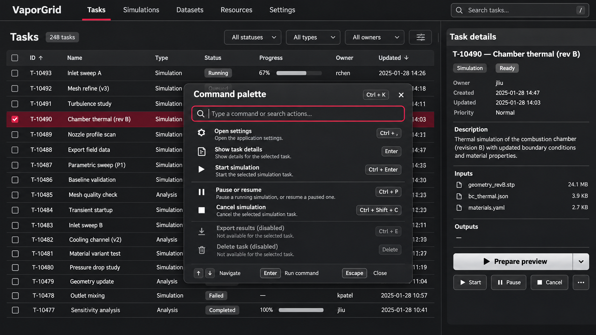
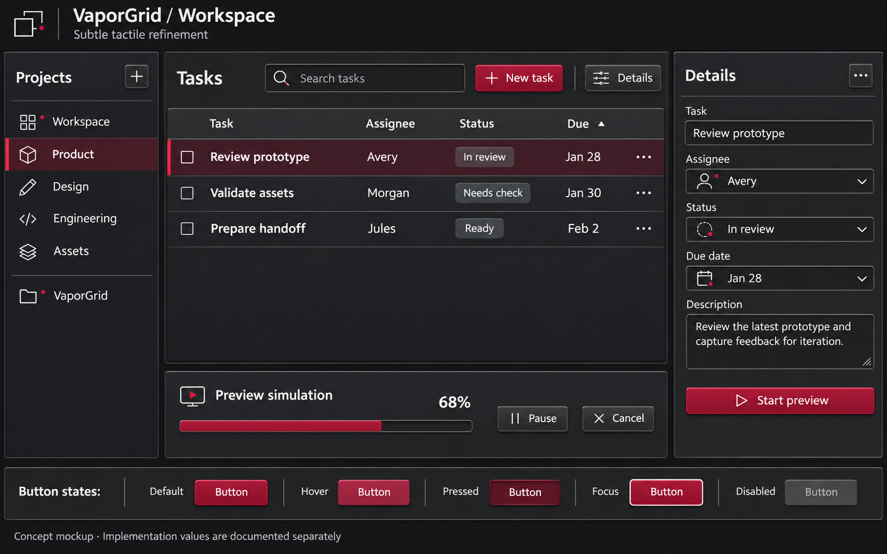
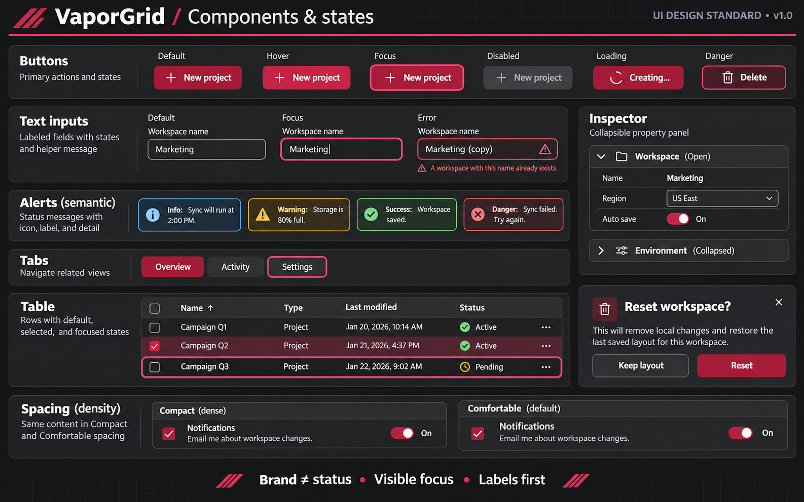

# VaporGrid

A dark, dense, tactile interface standard.

 · [Live demo](https://seanshaffer88.github.io/VaporGrid/demo/) · [Component examples](https://seanshaffer88.github.io/VaporGrid/#usage-heading) · [CC BY 4.0](LICENSE)

> [!NOTE]
> VaporGrid is for engineers and designers building desktop-class dashboards,
> editors, monitoring surfaces, and workflow tools. It specifies the spacing,
> hierarchy, and behavior needed for long sessions in high-density interfaces.

**Contents** · [Why this exists](#why-this-exists) · [Visual proof](#visual-proof) · [Design decisions](#design-decisions) · [Adopt VaporGrid](#adopt-vaporgrid) · [Open questions](#open-questions)

## Why this exists

Dense tools need enough structure for users to scan related controls, distinguish
the active task, and keep working as the workspace changes. VaporGrid uses opaque
charcoal layers to organize the screen, a restrained crimson accent to mark
interaction, and a keyboard path through each task.

## Visual proof

  

*Revision 5 concept mockup. The rendered demo uses the published tokens and its own implemented commands.*

Material and component state studies

  

*Earlier tactile material study. Inspect the current surface levels in the live component examples.*

  

*Earlier component state sheet. Use the live workspace and current guidance for behavior and color.*

## Design decisions

| Principle | Decision | Why it matters |
| --- | --- | --- |
| Density has rhythm | 6 CSS px minimum between distinct grouped controls, 8 px by default, 12–16 px between related groups, 24 px between sections | Makes groups scannable as layouts resize |
| Compartments support a judgment | Give each view a dominant metric or action and give each region a clear task | Establishes a reading order in dense views |
| Crimson carries meaning | Use it for a focus indicator, current state, or clearly labeled destructive action. Aim below 5% accent coverage as a design review budget | Preserves the accent as a signal |
| Elevation follows luminance | Use three charcoal levels for the workspace base, compartments, and raised surfaces, plus a visible selected fill. Specify colors in OKLCH | Keeps physical structure legible at low luminance |
| Typography supports long sessions | Use a 16 px body scale in the web reference, with weight and placement to distinguish headings and actions | Maintains legibility while preserving density |
| Keyboard access starts at the surface | Preserve logical Tab order and visible focus. Offer Commands or Ctrl/⌘+K for searchable actions | Gives keyboard users a direct path through the workspace |

Use text, shape, or programmatic state alongside color. Give the primary action
a neutral raised treatment with a clear verb, place it where the task calls for
it, and label destructive confirmations explicitly. Keep user-triggered motion
under 200 ms and respect reduced-motion settings.

VaporGrid targets [WCAG 2.2 AA](https://www.w3.org/TR/WCAG22/), including 4.5:1
contrast for normal text. The project's 44 × 44 CSS px touch policy is separate
from AA's 24 × 24 CSS px target-size criterion and its exceptions. The accent
budget is a review target. Consult the [verification record](docs/verification.md)
for the checks run and their limits.

### Responsive controls and Settings · revision 4

Settings opens in a right-edge drawer and can pin beside the workspace at
1640 CSS px. Appearance applies immediately. Layout stages Details width until
Apply or Cancel. Action buttons fill the available row space in source order.
See the [responsive mockup](assets/vaporgrid-responsive-settings.png) and
[behavior rules](docs/design-guidelines.md#responsive-controls-and-settings--revision-4).

## Adopt VaporGrid

- Start with the [design guidelines](docs/design-guidelines.md) and [component usage](docs/components.md).
- Use the [CSS custom properties](demo/tokens.css) or [JSON tokens](docs/tokens.json). Choose component states using the [materials guide](docs/materials.md).
- Native apps: take a generated export from [`dist/`](dist/). It contains [DTCG JSON](dist/vaporgrid.tokens.json), [WinUI 3](dist/VaporGrid.xaml), WPF [dark](dist/VaporGrid.Dark.xaml)/[light](dist/VaporGrid.Light.xaml), [Rust](dist/vaporgrid.rs), [Slint](dist/VaporGrid.slint) and [Godot](dist/vaporgrid_tokens.gd) files. All are generated from `docs/tokens.json` by `node tools/build-tokens.mjs`.
- Open the [live workspace](https://seanshaffer88.github.io/VaporGrid/demo/) or follow the [local setup](demo/README.md).
- Review the [changelog](CHANGELOG.md) and [contribution guide](CONTRIBUTING.md) when proposing a change. See [attribution](ATTRIBUTION.md) for reuse and provenance.

For the maintainer's projects, plan adoption for the next scheduled release and
show project-specific mockups for review before implementation.

### Concept gallery

Historical visual explorations include a [file utility](assets/vaporgrid-file-utility.png),
[IDE](assets/vaporgrid-ide.png), [video editor](assets/vaporgrid-video-editor.png),
[analytics dashboard](assets/vaporgrid-analytics-dashboard.png),
[productivity planner](assets/vaporgrid-productivity-planner.png), and
[mobile activity view](assets/vaporgrid-mobile-fitness.png).
See the [original icon sheet](assets/vaporgrid-icon-sheet.svg) and
[iconography guidance](docs/iconography.md).

## What shaped this revision

Earlier revisions explored tactile rims, shadows, and crimson primary buttons.
The current design uses luminance steps for structural depth and keeps crimson
for functional cues. The [changelog](CHANGELOG.md) tracks those design decisions.

## Open questions

- How well do the crimson signal and its supporting text or shape hold up for users with protanopia?
- Where should the density rhythm change on tablets and other touch hardware?
- Which contexts need a stronger secondary depth cue than luminance and borders provide?

If you build dark, dense tools, **where do you draw the line between tactile depth and visual noise?**

[Repository](https://github.com/SeanShaffer88/VaporGrid) · [Docs](docs/design-guidelines.md) · [Live demo](https://seanshaffer88.github.io/VaporGrid/demo/) · [Interaction reference](demo/README.md)
