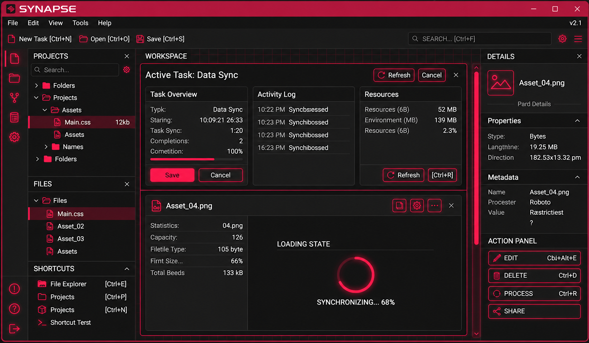
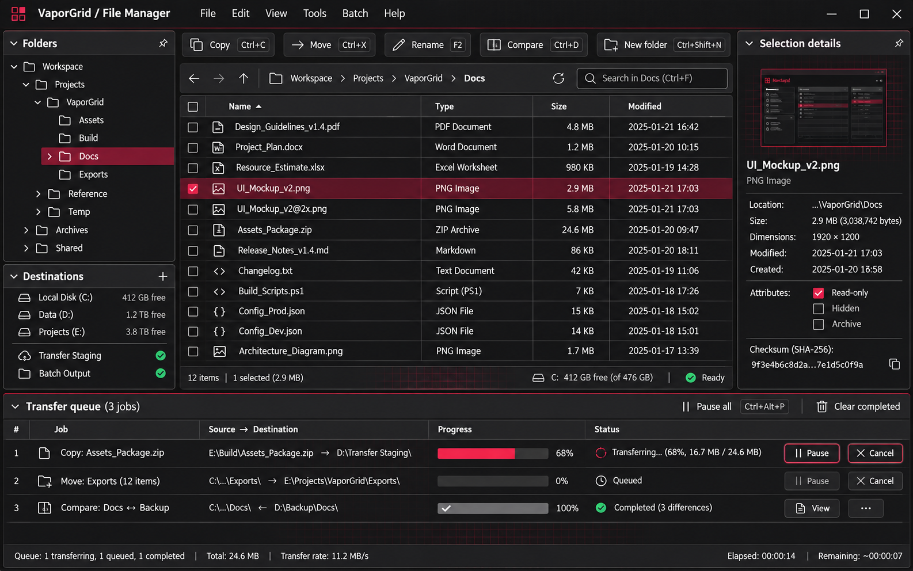
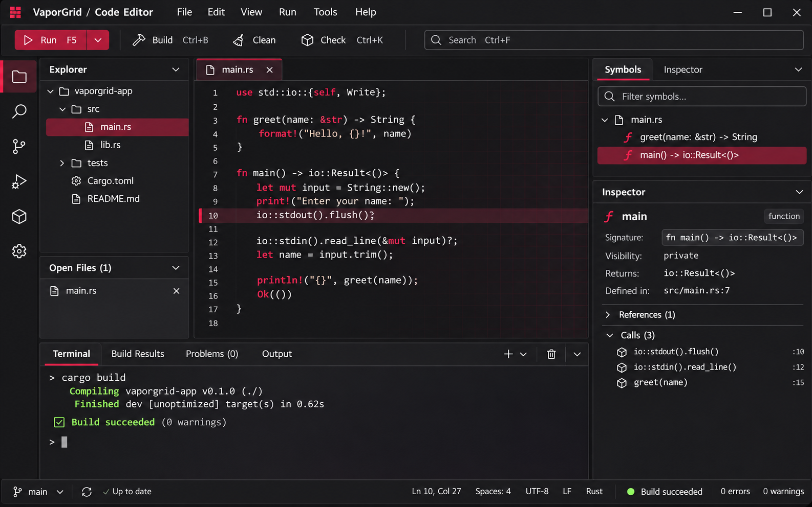
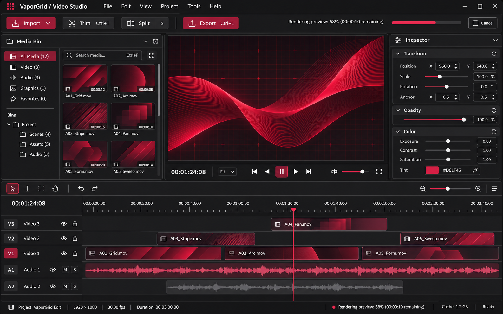
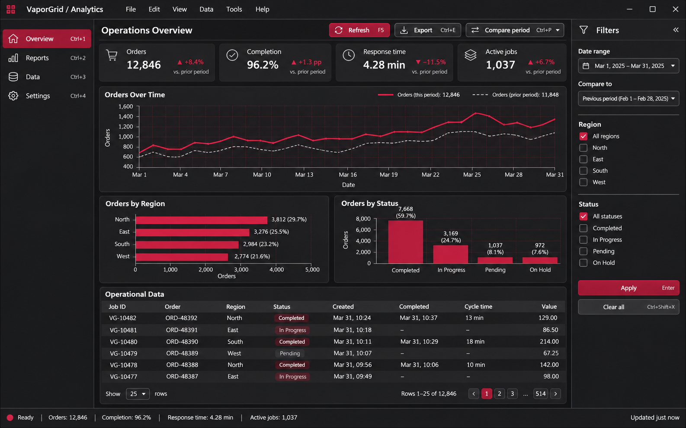
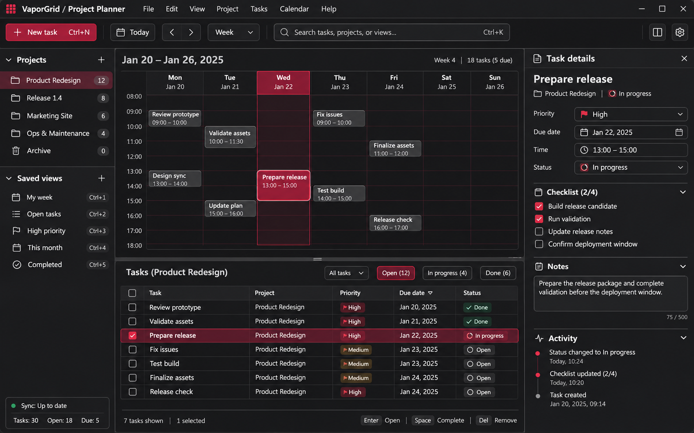
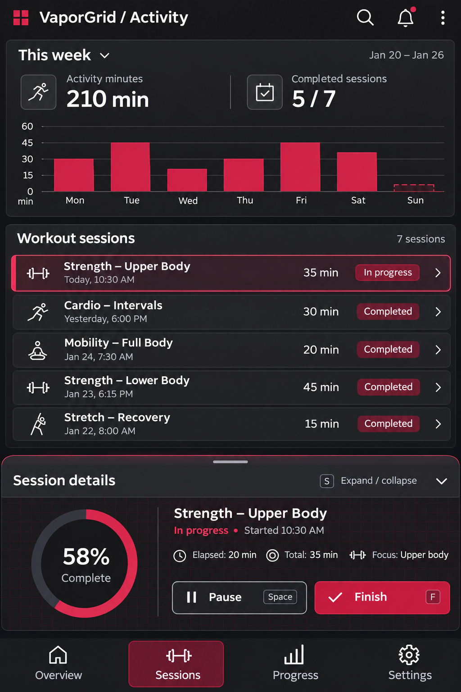

# VaporGrid

Charcoal and crimson interface concepts for dense, compartmentalized software.

[CC BY 4.0](LICENSE) · By [Sean Shaffer](https://github.com/SeanShaffer88)

[View the full-size reference](assets/reference/synapse-interface.png)

## Overview

VaporGrid is a collection of static interface concepts and practical design guidance. You can use it to explore balanced layouts, collapsible and resizable compartments, and restrained vaporwave grids and glow. The visual direction starts with Windows software and adapts to other platforms and application types without prescribing a framework.

This repository contains documentation and images, not working applications or a component library. The six showcase images are AI-generated fictional mockups. Their controls, charts, text, and status messages illustrate design direction; they do not demonstrate software functionality, accessibility certification, or third-party affiliation.

## Design principles

- **Keep work visible.** Use dense, balanced layouts with narrow gutters and clear alignment. Use symmetry where the task supports it.
- **Give each compartment a purpose.** Separate navigation, primary work, details, and status. Plan collapse and resize behavior around the user's task.
- **Reserve crimson for emphasis.** Use charcoal surfaces and high-contrast text; keep grids and active-edge glow subtle.
- **Make interaction legible.** Plan visible keyboard focus, discoverable shortcuts, selection states, and labels that do not depend on color alone.
- **Explain ongoing work.** Show meaningful progress and available actions. Accommodate reduced motion in implementations.

## Concept gallery

### File utility

Explore a folder tree, a dense file table, selection details, and a transfer panel with pause and cancel actions.

[View full-size file utility concept](assets/vaporgrid-file-utility.png)

### IDE

Arrange source navigation, editing, symbols, and terminal output in a balanced workspace. The build message belongs to the mockup, not an executed build.

[View full-size IDE concept](assets/vaporgrid-ide.png)

### Video editor

Group source media, a central viewer, clip properties, and timeline controls around the editing task.

[View full-size video editor concept](assets/vaporgrid-video-editor.png)

### Analytics dashboard

Combine summary metrics with charts and tabular detail. Treat the displayed data as fictional presentation content.

[View full-size analytics dashboard concept](assets/vaporgrid-analytics-dashboard.png)

### Productivity planner

Keep scheduled work, tasks, and selected-item details within a shared visual structure.

[View full-size productivity planner concept](assets/vaporgrid-productivity-planner.png)

### Mobile activity

Adapt the compartments to a narrow screen with touch spacing, a session list, and bottom details. Validate touch targets and reading order in the eventual implementation.

[View full-size mobile activity concept](assets/vaporgrid-mobile-fitness.png)

## Palette

| Role | Hex | Intended use |
| --- | --- | --- |
| Background | `#171719` | Workspace backdrop |
| Surface | `#202023` | Main compartments |
| Raised | `#29292D` | Elevated controls and detail surfaces |
| Foreground | `#F1F1F3` | Primary text |
| Muted | `#B7B7C1` | Secondary text |
| Accent | `#D61F45` | Selected states and emphasis |
| Focus | `#FF4D73` | Focus indicator direction |

Use the [measured contrast pairings](docs/design-guidelines.md#color-and-contrast) when choosing text colors. The [token file](docs/tokens.json) describes proposed values; it does not provide runtime behavior.

## Adopt the direction

Start with the [design guidelines](docs/design-guidelines.md). Map your users' tasks to compartments, create project-specific photo or image mockups, and test the resulting implementation on its target platform.

For the maintainer's projects, adopt VaporGrid at the **next planned release**, only after showing project-specific photo or image mockups for review **before implementation**. This policy guides the maintainer's rollout; it adds no condition to the CC BY 4.0 license for other reusers. It does not promise a broad rewrite of existing projects.

## Resources

- [Design guidelines](docs/design-guidelines.md): layout, interaction, adaptation, and implementation targets.
- [Descriptive tokens](docs/tokens.json): palette, spacing, typography, and motion direction.
- [Image generation notes](docs/image-generation-notes.md): shared prompt, scenarios, and reference processing.
- [Contributing](CONTRIBUTING.md): propose focused design changes with mockups and provenance.
- [Attribution](ATTRIBUTION.md): image sources and a reuse example.

## Attribution and license

Sean Shaffer licenses the repository's documentation and images under [Creative Commons Attribution 4.0 International](https://creativecommons.org/licenses/by/4.0/). Read the [license text](LICENSE) and preserve attribution, a license link, and an indication of changes when you adapt the work. See [ATTRIBUTION.md](ATTRIBUTION.md) for the image inventory and example credit.
