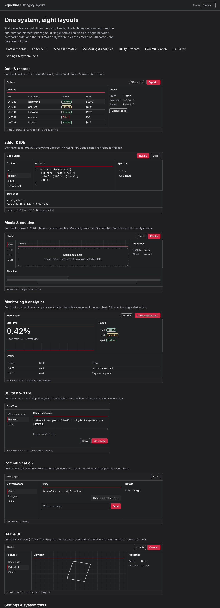

# Category layouts

VaporGrid applies to any desktop product by changing which region dominates, not by changing the system. Each archetype below keeps the same tokens, edges, one crimson element per region, and the same keyboard contract. See them live in the [category demo](https://seanshaffer88.github.io/VaporGrid/demo/categories/).

*Screenshot of the running category demo. All names and data are fictional.*

## How to adapt

1. Name the view's one judgment ("Which order needs attention?").
2. Choose the archetype closest to the work. Mix them for compound products.
3. Give the dominant region its share, then place supporting regions around it.
4. Set density per component class. Choose the single primary action.
5. Check the [fit rule](design-guidelines.md#layout) and keyboard paths.

## Archetypes

| Archetype | Dominant region | Typical regions | Density notes | Primary action | Special rules |
| --- | --- | --- | --- | --- | --- |
| Data & records | Table (≈65%) | Filters, details inspector, status | Rows Compact, forms Comfortable | Export, Run, Save | Virtualize. Sort and selection are keyboard operable. Selected row uses `selected` fill plus marker |
| Editor & IDE | Editor (≈55%) | Explorer, symbols, terminal, status | Everything Compact | Run | Syntax colors never use brand crimson. Errors use `danger` with an icon |
| Media & creative | Canvas (≈70%) | Tool rail, properties, timeline | Toolbars Compact, properties Comfortable | Render, Export | Chrome recedes. Grid appears as the empty canvas. Canvas content is exempt from the palette |
| Monitoring & analytics | One metric or chart | Node list, events, filters | Rows Compact | Acknowledge, Resolve | Every chart has a table alternative and a text summary. Series colors do not use brand crimson. Status needs words |
| Utility & wizard | Current step | Step list, progress, actions | Comfortable | Continue, Start | No scrollbars. Preview before destructive work. Cancel always reachable |
| Communication | Conversation (≈50%) | Conversation list, contact detail | Rows Compact | Send | Asymmetric by design. Unread uses text and weight, not color alone |
| CAD & 3D | Viewport (≈70%) | Feature tree, properties, command line | Compact | Commit | The viewport may use depth, perspective and its own palette. Chrome stays flat. Provide keyboard orbit, pan and zoom |
| Settings & system tools | The form | Section list, staged Apply/Cancel | Comfortable | Apply | Immediate and staged settings are clearly separated. Draft survives section changes. Search sections when there are many |

## Compound products

A video editor is Media with an Editor-style timeline. An email client is Communication with Data-style rows. A package installer is a Wizard whose last step is Monitoring. Keep one dominant region per window, and let secondary windows pick their own archetype.

## Beyond these eight

Games, kiosks, and touch-only appliances sit outside the standard's scope. Use the tokens and the accessibility rules, and choose density and input targets for the device.
