# Revision 5 materials

Opaque matte compartments use three charcoal levels. The workspace background uses `--surface-1`, structural panels use `--surface-2`, and raised surfaces and row hover use `--surface-3`. Selected rows, the current navigation item and secondary control hover use `--surface-4` (`selected`), a fill that stays visible against the panel. Flat table content keeps its existing boundaries. Fine rims and shallow field insets retain the tactile treatment. [Reusable CSS tokens](../demo/tokens.css) · [Machine-readable values](tokens.json)

Primary actions default to a neutral solid fill and a semibold label. A lighter hover fill and a deeper pressed fill show feedback while keeping the control in place. Disabled controls use Surface, a muted label, and a dashed boundary. Focus and selection use dedicated indicators. Progress and the optional decorative edge use neutral tones. Error, warning, success, and information keep their own semantic colors and labels.

Body typography starts at 16 CSS pixels under default browser settings and follows user font sizing. Smaller labels and metadata retain their contrast. Grouped controls default to 8px gaps with a 6px minimum. Narrow layouts and coarse pointers use a 44 by 44px minimum for standalone interactive controls and their clickable labels. The reference keeps the 180ms drawer entrance and limits nonessential transitions to 200ms. Reduced-motion and forced-color preferences use the browser’s corresponding modes.

## Deep crimson accent

VaporGrid's brand and action accent fill defaults to `#76172A` in both themes and stays constant across appearance presets. Pair `accent` with `accentForeground` (`#F1F1F3`) for labels. The pairing measures 9.66:1. Provide a visible control boundary where the fill alone has insufficient contrast with its surroundings. Use `selectionIndicator` and `focus` for thin state cues, and system colors in forced-color mode.

### Appearance presets

Keep theme and accent color as independent choices. The demo offers Crimson, Blue, and Teal. Crimson uses the base theme values. Blue and Teal update the selection marker and focus outline immediately, with distinct cues in each effective theme. Retain the selected fill, semantic colors, deep-crimson action fill, and textual or programmatic cues.

| Preset | Dark selection | Dark focus | Light selection | Light focus |
| --- | --- | --- | --- | --- |
| Crimson | `#DC2749` | `#FF4D73` | `#9E1534` | `#D61F45` |
| Blue | `#5FA8FF` | `#ACD1FF` | `#1558A6` | `#327AD1` |
| Teal | `#37B7AF` | `#8FE4D9` | `#00665F` | `#13877F` |

Web consumers set `data-accent` on the document root alongside `data-theme`. The generated CSS resolves Light, Dark, and System and uses `Highlight` for both cues in forced colors. Preserve an independent outline and selection marker so both remain identifiable when the system supplies the same color.

Native consumers keep the base dark/light palette API and apply the two overrides from the preset map for the effective theme. Store a validated preset ID and fall back to Crimson when it is missing or unknown. Reapply the preset when the effective theme changes and defer to native highlight colors in high contrast. The base XAML, Rust, Slint, and Godot exports continue to supply the default theme palettes. Alternate sRGB values are available under `color.accentPresets` in [generated DTCG JSON](../dist/vaporgrid.tokens.json) and as sRGB and OKLCH in [source tokens](tokens.json).

### Color roles

| Role | CSS token | Dark default sRGB | Light default sRGB | Application |
| --- | --- | --- | --- | --- |
| Accent fill | `--accent` | `#76172A` | `#76172A` | A deliberate brand or action fill with a visible boundary. |
| Accent label | `--accent-foreground` | `#F1F1F3` | `#F1F1F3` | Text or a labeled icon on the accent fill. |
| Keyboard focus | `--focus` | `#FF4D73` | `#D61F45` | An independent outline with a visible offset. Check contrast against adjacent surfaces and fills. |
| Selection | `--selection-indicator` | `#DC2749` | `#9E1534` | A marker beside the selected item. Pair with `--selected` and expose the selected state through the control. |
| Error | `--danger` | `#FFB1A8` | `#9D2B1F` | A labeled error with the affected input and next action. |
| Warning | `--warning` | `#F2CD82` | `#735100` | A named warning with the required action. |
| Success | `--success` | `#8FD4AD` | `#236340` | A labeled completion or recovery result. |
| Information | `--info` | `#9FC9FF` | `#174E85` | An explanatory label or message. |

The table shows the default Crimson cues. Use the [appearance preset](#appearance-presets) values for Blue and Teal. Check the rendered token pairing against its actual surroundings, including a selected item with keyboard focus. In forced colors, use system colors with visible text, outlines, and native state. [Generated CSS tokens](../demo/tokens.css) · [OKLCH and fallback values](tokens.json)

## Dark tread plate

Use a subtle tread-plate finish on dark workspace backgrounds. Arrange equal square tiles in an aligned grid with faint seams. Set four small raised diamonds in each tile, alternating their diagonals. Use a faint neutral highlight and a shallow shadow against the charcoal base. Keep the pattern static and decorative, with no input or state meaning. Keep fields, buttons, table rows, and focused or selected fills solid.

Use the flat background in Light and forced-color modes, including when System resolves to Light. Check label, boundary, selection, and focus contrast against the brightest rendered ridge. Apply the existing 4.5:1 normal-text and 3:1 required non-text contrast targets.

### Presets

| Preset | Tile geometry | Relief budget | Use |
| --- | --- | --- | --- |
| Square tread | 32 × 32 CSS px, 1 CSS px seam, four alternating diagonal treads | At most 1.15:1 between the brightest and darkest pixels | Exposed dark workspace backgrounds. Repeat at the same size along both axes. |
| Flat | Solid surface | 1:1 within the fill | Light and forced-color modes, dense reading surfaces, fields, and controls. Also offer it as a dark workspace preference. |

The reference swatch uses `#1F1F21` for the base, `#27272A` for the lightest ridge, and `#1C1C1E` for its shadow. Keep the lightest-to-darkest contrast at or below 1.15:1. The swatch measures 1.14:1. Against the brightest ridge, the sRGB token minima are 7.49:1 for body and muted text, 8.59:1 for semantic text, 4.83:1 for the control boundary, 4.65:1 for focus, and 3.14:1 for the selection marker. Recheck rendered colors if the pattern or palette changes.

## Measured palette contract

The dark Background, Surface, and Raised OKLCH lightness values are 0.240, 0.247, and 0.254, with constant chroma and hue. Their linear-sRGB relative luminance increases by 9.01% and 8.75%. The rounded sRGB fallback steps are 9.78% and 6.70%. The 5–10% target applies to the relative change from each preceding dark surface. [CSS Color 4 conversion method](https://www.w3.org/TR/css-color/#color-conversion-code)

| Checked pairing | Dark minimum | Light minimum |
| --- | ---: | ---: |
| Body and muted labels on four surfaces | 7.32:1 | 5.89:1 |
| Semantic labels on four surfaces | 8.39:1 | 5.30:1 |
| Primary label in default, hover, and pressed states | 8.95:1 | 9.27:1 |
| Focus outline on four surrounding surfaces | 4.55:1 | 3.75:1 |
| Control boundary across surfaces and primary states | 3.28:1 | 3.19:1 |
| Selection indicator on four surfaces, including the selected fill | 3.07:1 | 5.95:1 |

Fills that mean different states must also differ from each other. These are fill-to-fill ratios, so they support recognition rather than replace boundaries, markers and labels.

| Distinctness check | Dark | Light | Minimum |
| --- | ---: | ---: | ---: |
| Selected fill against Surface | 1.11:1 | 1.35:1 | 1.10:1 |
| Primary action against Raised | 1.36:1 | 1.21:1 | 1.05:1 |
| Focus against selection indicator (a focused selected item shows two cues) | 1.48:1 | 1.59:1 | 1.30:1 |

Figures are rounded for display. `node --test demo/tokens.test.mjs` compares unrounded ratios in both encodings, checks CSS and JSON agreement, validates the dark surface steps, and enforces the distinctness minimums. `node tools/build-tokens.mjs --check` confirms that generated outputs match `tokens.json`. [W3C non-text contrast guidance](https://www.w3.org/WAI/WCAG22/Understanding/non-text-contrast)
